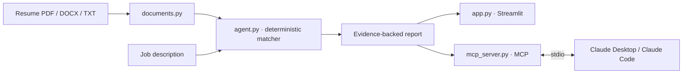

<div align="center">

# Resume Job Match Agent

### Evidence-first job application intelligence · Agent #10 of 200


**Understand the fit. Inspect the evidence. Improve the application truthfully.**

[](https://www.python.org/)
[](https://streamlit.io/)
[](https://modelcontextprotocol.io/)
[](LICENSE)
[](tests/)

[🚀 Start the tutorial](docs/01-getting-started.md) · [🤖 Connect Claude](docs/02-claude-integration.md) · [🧠 Understand the score](docs/03-analysis-playbook.md) · [🛠 Developer guide](docs/04-architecture-and-contributing.md) · [🧯 Troubleshooting](docs/05-troubleshooting.md)

</div>

---

## What it does

Upload a resume (PDF, DOCX, or TXT), paste a job description, and get a transparent report showing recognised skill matches, source sentences, inferred requirement priority, gaps, and next actions. The same analysis engine is available through a local MCP server, so Claude Desktop and Claude Code can call it as a tool.

**It is not an ATS simulator, a hiring prediction model, or a guarantee of interviews.** Its percentage is weighted coverage of skills detected by a curated vocabulary. Read the evidence and limitations before acting on a finding.

## Pick your path

| I want to… | Start here |
|---|---|
| Use the browser app | [Getting Started](docs/01-getting-started.md) |
| Use it inside Claude Desktop | [Claude Integration](docs/02-claude-integration.md) |
| Use it with Claude Code | [Claude Integration](docs/02-claude-integration.md#6-claude-code-route) |
| Understand the weighted score | [Analysis Playbook](docs/03-analysis-playbook.md) |
| Extend the code | [Developer Guide](docs/04-architecture-and-contributing.md) |
| Fix an error | [Troubleshooting](docs/05-troubleshooting.md) |

## Quick start — Windows PowerShell

Requirements: Python 3.11 or newer.

```powershell
git clone https://github.com/yerageracharan/resume-job-match-agent.git
cd resume-job-match-agent
py -3.11 -m venv .venv
.\.venv\Scripts\Activate.ps1
python -m pip install --upgrade pip
python -m pip install -r requirements.txt
python -m streamlit run app.py
```

Open the local URL printed by Streamlit (normally `http://localhost:8501`). Upload your resume, inspect the extracted text, paste the complete job description, and run the analysis. The detailed illustrated setup is in [Chapter 01](docs/01-getting-started.md).

## Claude integration

The repository includes a local MCP server with three tools:

| MCP tool | Purpose |
|---|---|
| `analyze_resume_match` | Analyse resume text against job-description text |
| `analyze_resume_file` | Read a user-selected local PDF/DOCX/TXT file and analyse it |
| `get_resume_evidence` | Retrieve sentences that support a skill mention |

On Windows, double-click `setup_claude_windows.bat`, then fully quit and restart Claude Desktop. See the [complete Claude integration chapter](docs/02-claude-integration.md) for verification, Claude Code setup, example prompts, and privacy boundaries.

## Architecture



The matching engine is shared by the browser UI and MCP server. The local matching process does not call an LLM or require an API key. When you ask Claude to inspect resume content, that content is processed by Claude under your account settings; this is not an offline Claude workflow.

## What the report means

- A skill is detected when one of the engine's configured phrases/aliases appears in the input.
- Required/preferred labels are **inferred** from nearby wording and can be wrong.
- Required-inferred skills receive weight 2; preferred/unclassified skills receive weight 1.
- The score is matched weight divided by total detected job-skill weight.
- A matched term is not proof of proficiency.
- The vocabulary is curated, not exhaustive; semantic similarity is not implemented in this version.

The [Analysis Playbook](docs/03-analysis-playbook.md) explains the formula, evidence rows, gap triage, and safe resume rewriting.

## Documentation with 50 visuals

The field manual contains 50 numbered Mermaid diagrams and an original Japanese-inspired developer mascot squad. GitHub renders the diagrams directly in Markdown.

- [01 · Getting Started — visuals 01–12](docs/01-getting-started.md)
- [02 · Claude Integration — visuals 13–24](docs/02-claude-integration.md)
- [03 · Analysis Playbook — visuals 25–38](docs/03-analysis-playbook.md)
- [04 · Developer Guide — visuals 39–40](docs/04-architecture-and-contributing.md)
- [05 · Troubleshooting — visuals 41–50](docs/05-troubleshooting.md)

[Open the documentation map](docs/README.md)

## Tests

```powershell
python -m unittest discover -s tests -v
```

## Project structure

```text
resume-job-match-agent/
├── agent.py
├── app.py
├── documents.py
├── mcp_server.py
├── configure_claude.py
├── setup_claude_windows.bat
├── requirements.txt
├── requirements-claude.txt
├── tests/
│   ├── test_agent.py
│   └── test_documents.py
├── docs/
│   ├── README.md
│   ├── 01-getting-started.md
│   ├── 02-claude-integration.md
│   ├── 03-analysis-playbook.md
│   ├── 04-architecture-and-contributing.md
│   ├── 05-troubleshooting.md
│   └── assets/dev-squad.webp
├── BENCHMARK.md
├── CLAUDE.md
└── LICENSE
```

## Privacy and responsible use

- Keep real resumes and private application data out of Git commits and public issues.
- The Streamlit matcher runs locally.
- The MCP server reads a local path only when the tool is given that path.
- Claude may process content supplied to it through an MCP tool call; understand your Claude account's data controls.
- Do not use this project to make automated hiring decisions.
- Never add a skill, employer, qualification, responsibility, result, or metric unless it is true and the user can support it.

## Contributing

See the [Developer Guide](docs/04-architecture-and-contributing.md) for code ownership, adding skills, safely changing scoring, test commands, and pull-request expectations. Please include regression tests and synthetic examples only.

## License

MIT. See [LICENSE](LICENSE).