# 01 · Getting Started — from zero to your first match

> **Audience:** first-time users on Windows, especially people who have never run a Python project before.  
> **Goal:** launch the app, load one resume, analyse one job description, and export a report without guessing what the score means.


**Meet the guide characters**

- **Senpai** — architecture mentor. Explains why the system is split into small parts.
- **Kōhai** — junior builder. Walks through setup commands one step at a time.
- **QA-chan** — evidence reviewer. Reminds you to verify every extracted claim.
- **Byte-kun** — MCP bridge. Helps connect the local engine to Claude.

The characters are original project mascots. They are visual guides, not software components.

## The 90-second mental model

You provide two things: a resume and a job description. The app extracts recognisable skills, checks which terms occur in both documents, attaches nearby evidence sentences, and builds a report. It does not decide whether a person should be hired.

### Visual 01 — The whole user journey

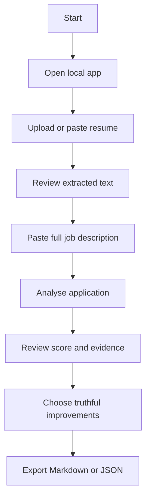

## 1. Know what you are installing

| Item | Why it exists | Do you need it? |
|---|---|---|
| Python 3.11+ | Runs the project | Yes |
| Git | Downloads the repository and tracks changes | Recommended |
| Streamlit | Gives you the browser interface | Yes for the UI |
| pypdf | Extracts selectable text from PDFs | Yes for PDF input |
| python-docx | Reads DOCX paragraphs and tables | Yes for DOCX input |
| MCP Python SDK | Exposes tools to Claude | Only for Claude integration |
| Anthropic API key | Not used by this project's local matcher | No |

### Visual 02 — What is required for each route

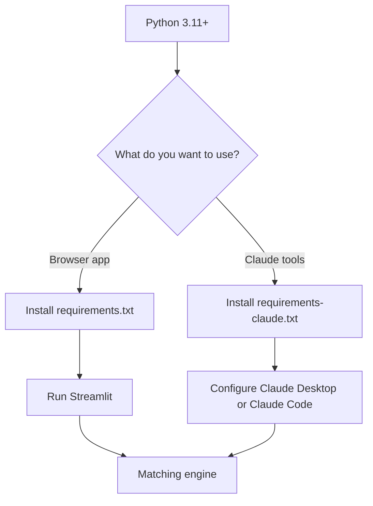

### Visual 03 — Repository map at a glance

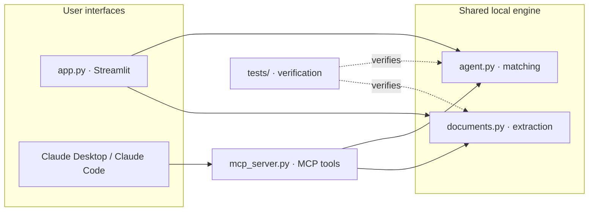

## 2. Download the project

### Option A — easiest: download a ZIP

1. Open the [GitHub repository](https://github.com/yerageracharan/resume-job-match-agent).
2. Select **Code**.
3. Select **Download ZIP**.
4. Open your Downloads folder.
5. Right-click the ZIP and choose **Extract All…**.
6. Move the extracted folder somewhere stable, for example `C:\Users\YOUR_NAME\Projects\resume-job-match-agent`.
7. Do not run scripts from inside the compressed ZIP preview.

### Visual 04 — ZIP download route

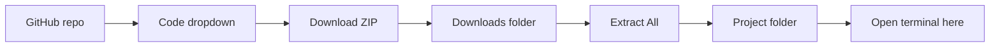

### Option B — recommended for developers: clone with Git

Install Git for Windows first, then open PowerShell:

```powershell
mkdir $HOME\Projects -Force
cd $HOME\Projects
git clone https://github.com/yerageracharan/resume-job-match-agent.git
cd resume-job-match-agent
```

If Git says `git is not recognized`, install Git for Windows, close the terminal, reopen it, and run `git --version`.

### Visual 05 — Clone versus ZIP

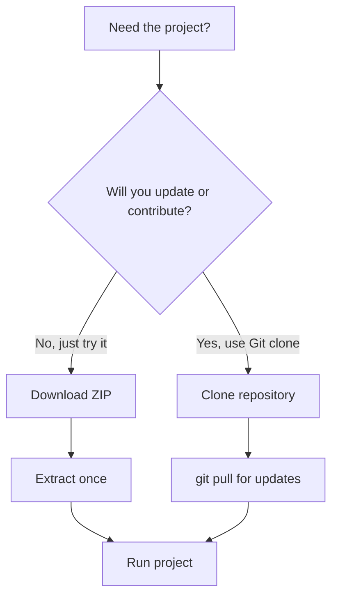

## 3. Install Python and verify it

Install Python **3.11 or newer** from the official [Python downloads page](https://www.python.org/downloads/windows/). In the installer, enable the option that adds Python to PATH. Keep the Python Launcher (`py`) enabled if offered.

Open a *new* PowerShell window and run:

```powershell
py --version
py -0p
```

Expected first line resembles `Python 3.11.x`, `Python 3.12.x`, or newer. If `py` is unavailable, try `python --version`. If neither works, reinstall Python and make sure PATH/launcher options are enabled.

### Visual 06 — Python verification decision tree

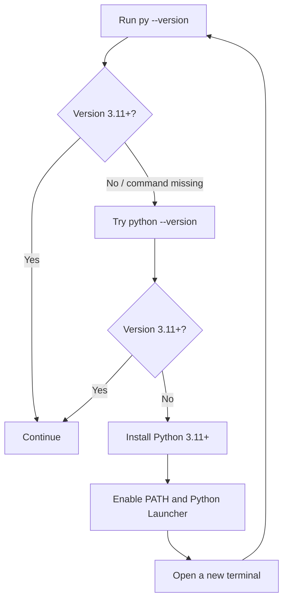

## 4. Open the terminal in the project folder

A terminal must be *inside* the directory that contains `app.py` and `requirements.txt`.

**PowerShell method:** open the project folder in File Explorer, click the address bar, type `powershell`, and press Enter.

Verify the folder:

```powershell
Get-Location
Get-ChildItem
```

You should see `app.py`, `agent.py`, `documents.py`, `mcp_server.py`, and `requirements.txt`.

### Visual 07 — Correct working directory

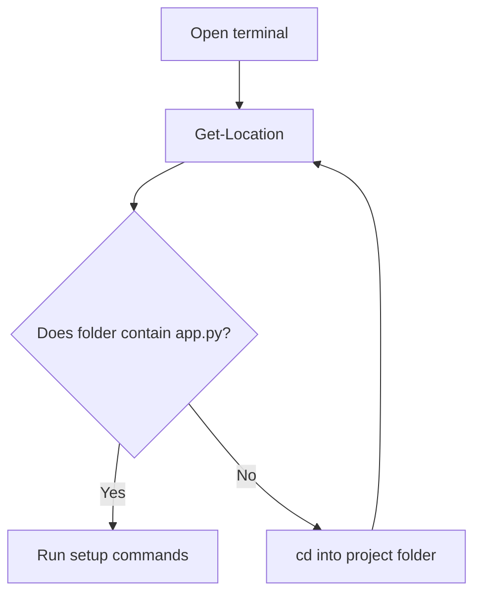

## 5. Create an isolated Python environment

A virtual environment keeps this project's packages separate from other Python projects.

Run in PowerShell:

```powershell
py -3.11 -m venv .venv
.\.venv\Scripts\Activate.ps1
```

If you installed Python 3.12 or later and do not have 3.11, replace `3.11` with the version you installed, for example `py -3.12 -m venv .venv`.

After activation, your prompt normally begins with `(.venv)`. Verify the interpreter:

```powershell
python --version
python -c "import sys; print(sys.executable)"
```

The printed executable should point inside the project's `.venv` folder.

**If PowerShell blocks activation:** you can avoid changing execution policy and call the virtual environment's Python directly:

```powershell
.\.venv\Scripts\python.exe -m pip install --upgrade pip
```

Or use Command Prompt instead:

```bat
.venv\Scripts\activate.bat
```

### Visual 08 — Virtual environment lifecycle

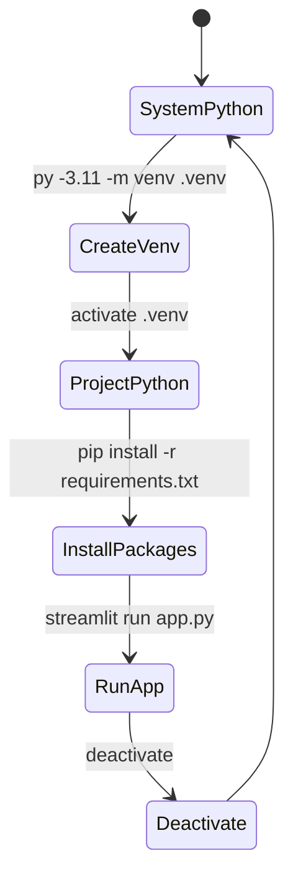

## 6. Install the browser-app dependencies

With the virtual environment active, run:

```powershell
python -m pip install --upgrade pip
python -m pip install -r requirements.txt
```

What happens:

- `streamlit` installs the browser interface.
- `pypdf` extracts text from selectable-text PDF files.
- `python-docx` extracts paragraphs and tables from DOCX files.
- `mcp` is listed in the main requirements so the same environment can also run Claude integration.

Installation can take a little time depending on your internet connection. It is a one-time step per environment unless dependencies change.

### Visual 09 — Dependency installation

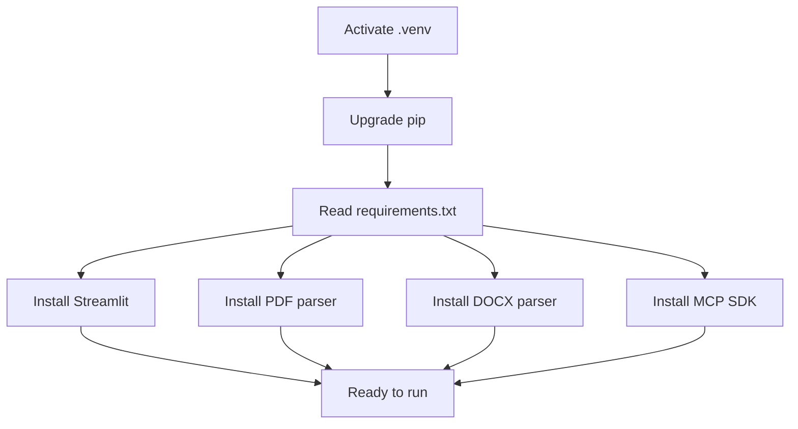

## 7. Launch the app

Run:

```powershell
streamlit run app.py
```

Streamlit prints a local address, usually `http://localhost:8501`. Open it in your browser. The application is running on your own computer; the browser is simply the interface.

To stop the app, return to the terminal and press `Ctrl+C`.

### Visual 10 — Local app launch sequence

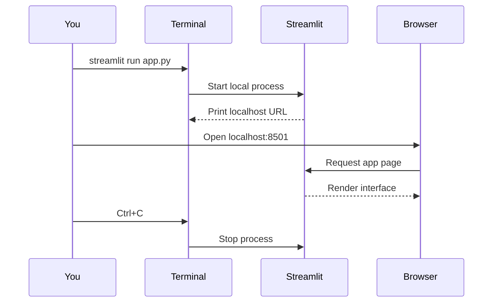

## 8. Run your first analysis

Prepare a resume in PDF, DOCX, or TXT format. Prepare the complete job description, not only the job title or the first paragraph.

1. Select **Upload PDF, DOCX, or TXT**.
2. Wait for the extraction confirmation.
3. Read the extracted text in the resume text box. Correct obvious extraction mistakes before analysis.
4. Paste the full job description into **Target job**.
5. Select **Analyse this application**.
6. Inspect the weighted coverage percentage.
7. Expand every matched or missing skill and read its resume evidence and job-description context.
8. Open **Next actions** and decide which recommendations are valid for your actual experience.
9. Download the Markdown report for humans or JSON for programmatic use.

### Visual 11 — First analysis workflow

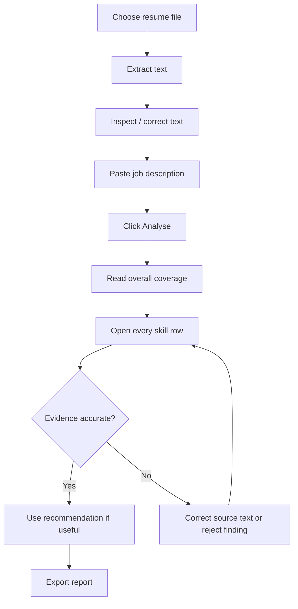

## 9. Understand the result before acting on it

The percentage is **weighted coverage of skills recognised by the current built-in vocabulary**. It is not an ATS score, ranking, interview probability, or judgement of your professional quality.

Example:

| Job-description skill | Inferred priority | Weight | Appears in resume? | Earned weight |
|---|---:|---:|---:|---:|
| Python | Required | 2 | Yes | 2 |
| SQL | Required | 2 | Yes | 2 |
| AWS | Preferred | 1 | No | 0 |
| **Total** |  | **5** |  | **4** |

`4 / 5 × 100 = 80%` weighted recognised-skill coverage.

### Visual 12 — Weighted coverage example

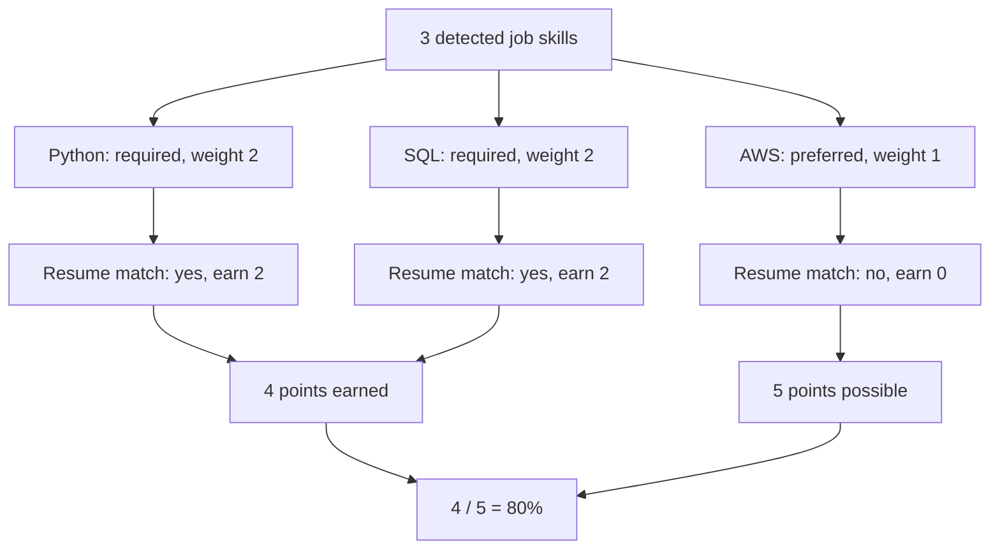

**Kōhai checkpoint:** do not chase the number. Chase a truthful, well-evidenced application. A low score can reflect missing vocabulary or parsing errors; a high score can still hide weak evidence or poor role fit.

---

**You completed Chapter 01.** The app is running, you have analysed a real job, and you know what the score does and does not say. Next: connect the same engine to Claude.