# 02 · Claude Integration — give Claude tools, not another chatbot

> **Audience:** users who want Claude Desktop or Claude Code to call the local Resume Job Match Agent.  
> **Goal:** configure the MCP server, verify its tools, and use Claude without exposing more data than the task requires.


**Byte-kun's rule:** MCP is a bridge between a host application and local tools. The matcher does not become Claude, and Claude does not become the matcher. The host calls the server; the server returns structured findings.

## 1. Understand the connection

MCP means **Model Context Protocol**. In this repository, the MCP server uses the local Python process and the `stdio` transport. Claude starts the process and communicates with it through standard input/output. There is no public web server or port to expose for this local setup.

### Visual 13 — Claude and the local MCP server

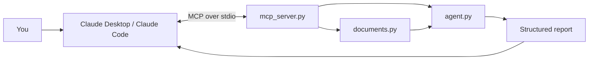

### Visual 14 — Who is who in MCP?

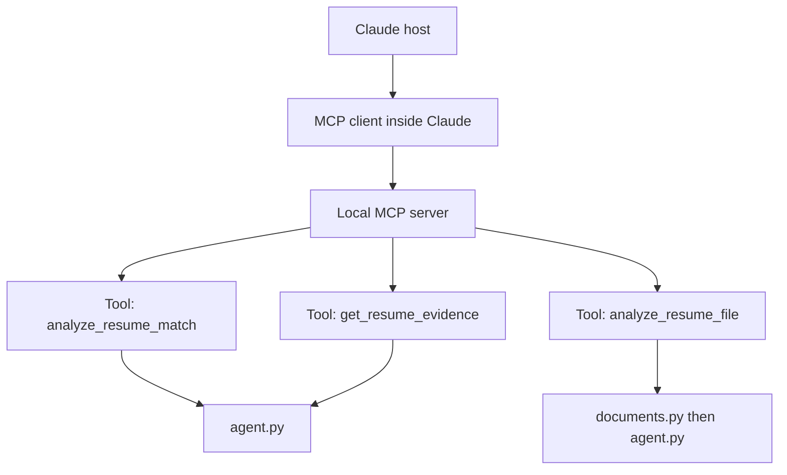

## 2. Before setup

- [ ] Python 3.11 or newer is installed.
- [ ] The repository is extracted to a stable folder.
- [ ] You have opened Claude Desktop at least once.
- [ ] You can locate the repository folder in File Explorer.
- [ ] You understand that resume content sent to Claude is processed under your Claude plan/account settings.

The local matching engine does not require an Anthropic API key. Claude Desktop still needs a valid Claude account/plan for Claude itself.

## 3. Recommended route: automatic Windows setup

This is the simplest path for most Windows users. **The included batch file currently invokes `py -3.11`, so install Python 3.11 specifically to use this one-click script.** The Python 3.11+ requirement refers to the MCP SDK; if you only have a later Python version installed, use the manual setup steps below and run `configure_claude.py` with that environment.

1. Open the extracted `resume-job-match-agent` folder.
2. Double-click `setup_claude_windows.bat`.
3. A Command Prompt window opens. Keep it open until the script reaches the completion message.
4. The script checks for the Python Launcher.
5. It creates `.venv` if it does not already exist.
6. It installs the packages listed in `requirements-claude.txt` into that environment.
7. It runs `configure_claude.py` using the virtual environment's Python.
8. The configurator adds or replaces only the `resume-job-match` entry in Claude's `mcpServers` object, preserving other server entries in valid existing JSON.
9. Fully quit Claude Desktop and reopen it.
10. Open **Settings → Developer** and inspect the MCP server status.

### Visual 15 — What the setup script does

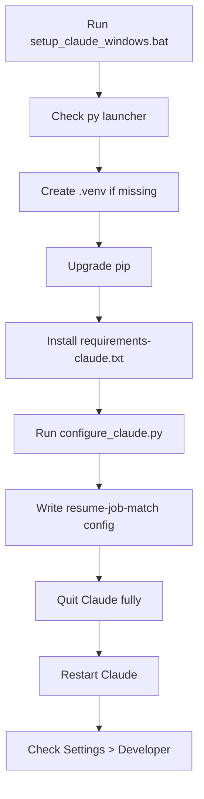

### Visual 16 — Claude Desktop config location

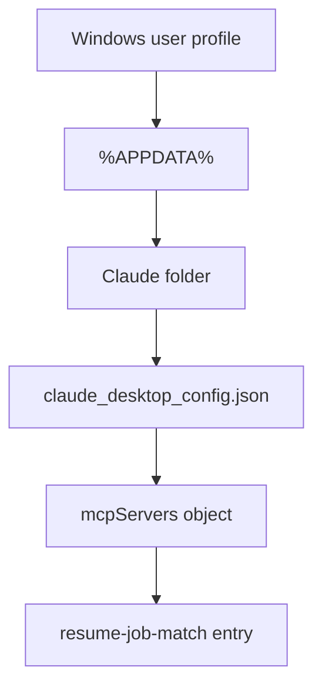

The configurator uses `%APPDATA%\Claude\claude_desktop_config.json` on Windows. It stores absolute paths to the selected Python executable and `mcp_server.py`, so **do not move the repository after configuring Claude**. If you move it, run the setup script again from the new location.

## 4. What the configuration means

A typical entry looks like this. Your own absolute paths will differ:

```json
{
  "mcpServers": {
    "resume-job-match": {
      "command": "C:\\path\\to\\resume-job-match-agent\\.venv\\Scripts\\python.exe",
      "args": [
        "C:\\path\\to\\resume-job-match-agent\\mcp_server.py"
      ]
    }
  }
}
```

This is a reference example, not a file to paste literally. Use the included configurator so the paths are correct for your computer.

### Visual 17 — Configuration-to-process mapping

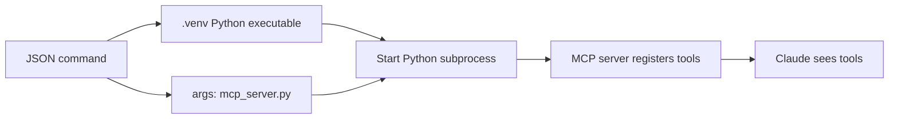

## 5. Verify the integration

After restarting Claude Desktop:

1. Open **Settings → Developer**.
2. Find `resume-job-match`.
3. Confirm that the server is connected/available and no startup error is displayed.
4. In a new chat, ask Claude to list or use the Resume Job Match Agent tools.
5. If your Claude Desktop version presents tool controls differently, use the interface's connected-server/tool indicator and its logs rather than assuming the server is absent.

### Visual 18 — Verification ladder

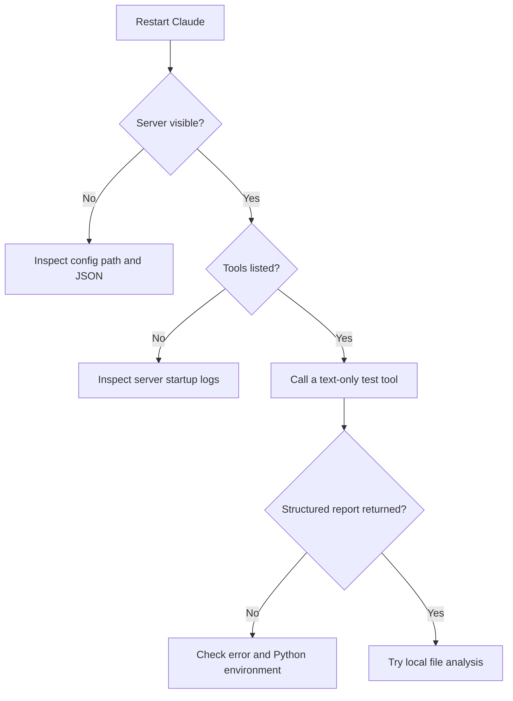

## 6. Claude Code route

Claude Code is a separate product from Claude Desktop. Install Claude Code and sign in first. Then open a terminal in the project folder and install the Claude MCP dependencies:

```powershell
py -3.11 -m venv .venv
.\.venv\Scripts\python.exe -m pip install --upgrade pip
.\.venv\Scripts\python.exe -m pip install -r requirements-claude.txt
```

Register the server in Claude Code:

```powershell
$python = (Resolve-Path ".\.venv\Scripts\python.exe").Path
$server = (Resolve-Path ".\mcp_server.py").Path
claude mcp add --scope user --transport stdio resume-job-match -- "$python" "$server"
claude mcp get resume-job-match
```

`--scope user` makes this server available across your Claude Code projects. Omit it or choose another supported scope when you prefer a narrower configuration. The `--` separator is important: it tells Claude Code that the command and arguments after it belong to the local server process. After registration, start Claude Code and run:

```text
/mcp
```

Use the MCP panel/list to verify that `resume-job-match` is connected and its three tools are available. The `claude mcp get` command provides a terminal-side status check. See the current [Claude Code MCP reference](https://code.claude.com/docs/en/mcp) for version-specific options.

### Visual 19 — Claude Code registration path

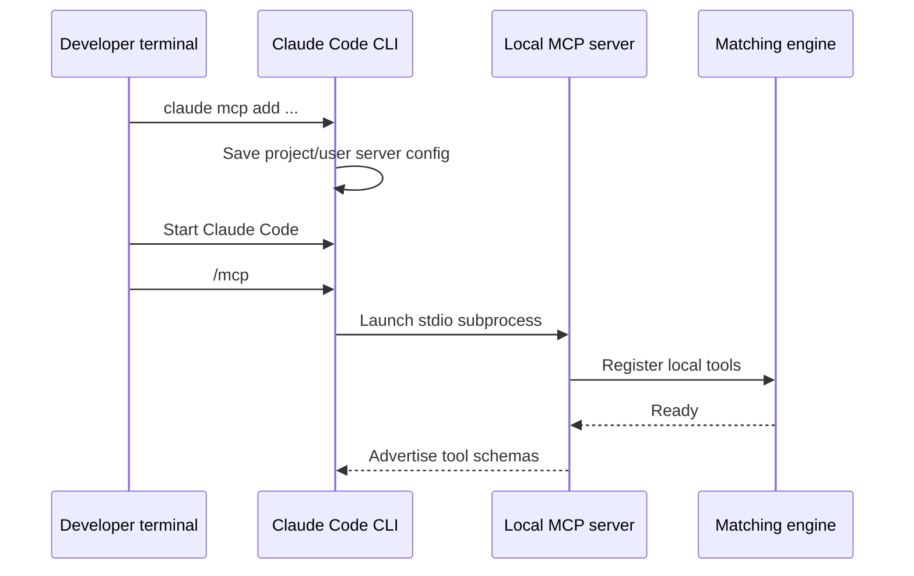

## 7. The three tools Claude receives

| Tool | Inputs | What it does | Use it when |
|---|---|---|---|
| `analyze_resume_match` | `resume_text`, `job_description` | Runs the matcher on text and returns the full structured report plus Markdown | Resume text is already available in the conversation or a text source |
| `analyze_resume_file` | `resume_path`, `job_description` | Reads the user-selected local PDF/DOCX/TXT file, then runs the matcher | You want Claude to ask the local server to read a file path on the same machine |
| `get_resume_evidence` | `resume_text`, `skill` | Finds resume sentences that mention the requested skill | Claude is drafting a bullet or checking whether a claim has evidence |

### Visual 20 — Tool selection flow

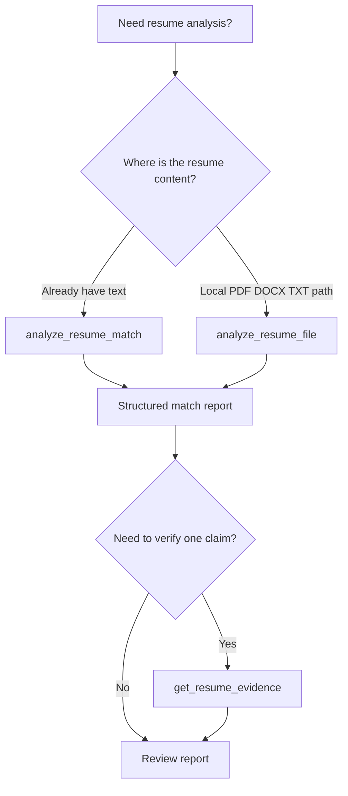

### Visual 21 — What a tool call returns

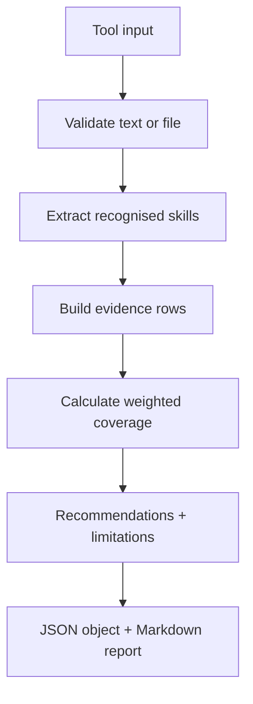

### Visual 22 — Data boundary: local matcher versus Claude

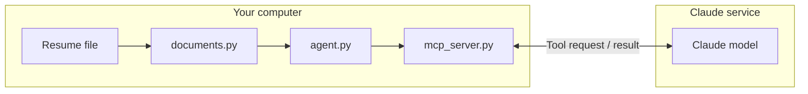

**Important privacy detail:** the local engine does not make an API call, but when Claude receives resume text or the tool result, that content is being used within Claude under the account's policies and settings. This is not a fully offline Claude workflow.

## 8. Prompts that get useful results

### Prompt A — careful first analysis

```text
Use the Resume Job Match Agent MCP tool to analyse my resume against this job description.

1. Explain the weighted coverage score in plain English.
2. Show the matched skills and quote the resume evidence for each one.
3. Separate inferred required, preferred, and unclassified gaps.
4. Tell me which findings may be caused by vocabulary or document parsing limits.
5. Do not call this an ATS score or estimate my chance of getting hired.
6. Do not add facts that are not in my resume.
```

### Prompt B — truthful bullet improvement

```text
Review the report and help me improve the resume bullets that already have evidence.
For every proposed rewrite:
- show the original sentence;
- show the proposed sentence;
- list the exact evidence supporting it;
- mark any missing number, outcome, tool, or responsibility as [ASK USER];
- do not invent metrics, ownership, seniority, or business impact.
Ask me before adding any fact that is not explicitly supported.
```

### Prompt C — interview preparation from evidence

```text
Use the detected matches and my resume evidence to create interview practice.
For each matched skill, create one question about a real project or task in my resume.
For every gap, suggest a learning exercise—not a claim to put on the resume.
Keep the difference between demonstrated experience and planned learning explicit.
```

### Visual 23 — Safe drafting loop

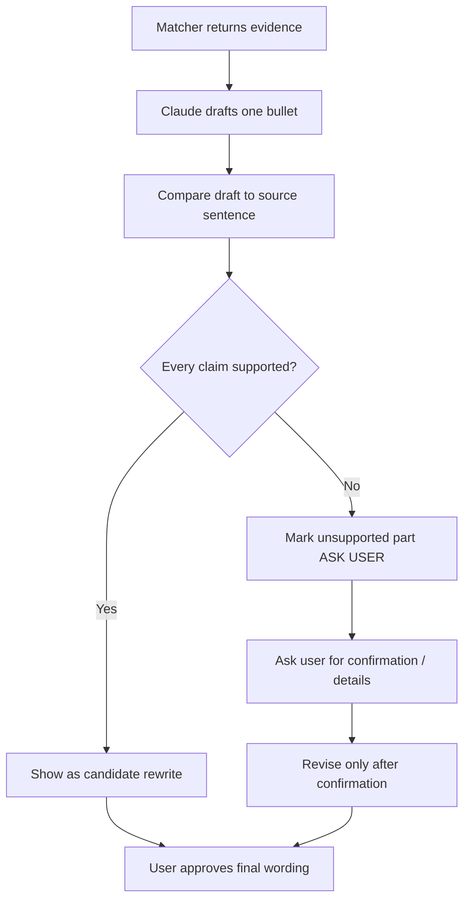

## 9. Common integration mistakes

- **Moving the folder after setup:** absolute paths become stale. Run setup again.
- **Installing packages globally:** install into the `.venv` interpreter referenced by the MCP config.
- **Forgetting the restart:** fully quit and reopen Claude Desktop after changing its config.
- **Editing JSON carelessly:** one missing comma can prevent all configured MCP servers from loading. The setup script preserves valid existing configuration; keep a backup before manual edits.
- **Expecting an API key prompt:** the local matcher does not need one.
- **Expecting offline Claude:** Claude still processes content sent into the conversation/tool cycle.

### Visual 24 — Integration troubleshooting route

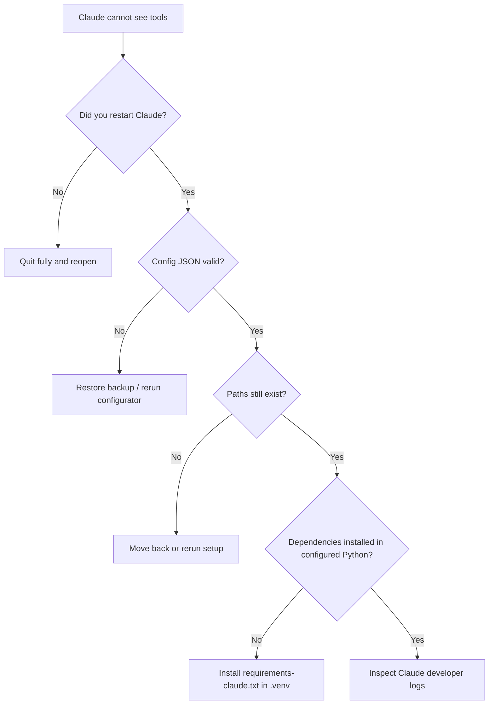

---

**Byte-kun status:** Claude can now call local analysis tools. Next chapter: learn how to interpret the output, challenge weak matches, and turn findings into a better application plan.