# 03 · Analysis Playbook — turn a score into a better application

> **Audience:** job seekers, career changers, and developers testing the matching engine.  
> **Goal:** understand what the engine detects, what it misses, and how to use its output without gaming the score or fabricating qualifications.

**QA-chan's principle:** a matched word is a lead to inspect, not proof that someone is proficient. Read the evidence before trusting the result.

## 1. Prepare a good input pair

A useful analysis depends on the quality of the two inputs.

### Resume checklist

- Use the most recent version of your resume.
- Include the real projects, jobs, education, tools, and outcomes relevant to the role.
- Use selectable text in PDF rather than a photo of a printed page.
- Make sure the file is not password-protected.
- Keep tables simple where possible; complex layouts can affect reading order.
- Check the extracted text box before you click Analyse.
- Remove private details that are not needed for the review (full home address, government identifiers, private phone numbers, or references' contact details).

### Job-description checklist

- Paste the complete description, including responsibilities and qualifications.
- Preserve wording such as `required`, `must have`, `preferred`, and `nice to have` because the current priority heuristic looks for wording around skill mentions.
- Do not paste only the company mission or a generic job title.
- If a requirement is ambiguous, verify it manually on the original posting.

### Visual 25 — Input quality funnel

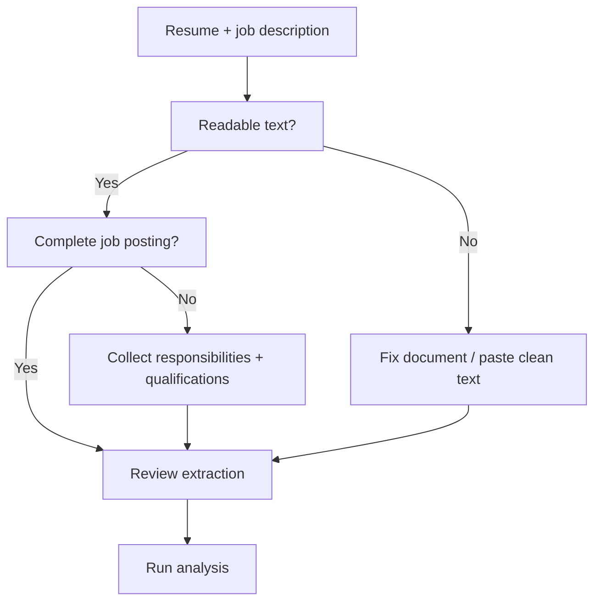

## 2. What exactly is a “skill” to this engine?

`agent.py` contains a curated dictionary named `SKILL_ALIASES`. Each canonical skill maps to common spellings. For example, `react` recognises `React`, `React.js`, and `ReactJS`; `postgresql` recognises `Postgres`; and `natural language processing` recognises `NLP`.

Detection is phrase-based and uses token boundaries to avoid some accidental substring matches. It is not semantic understanding. A sentence that says “built a forecasting model” may not match “machine learning” unless a recognised phrase appears. The current vocabulary is a starting set, not a complete labour-market ontology.

### Visual 26 — Alias resolution

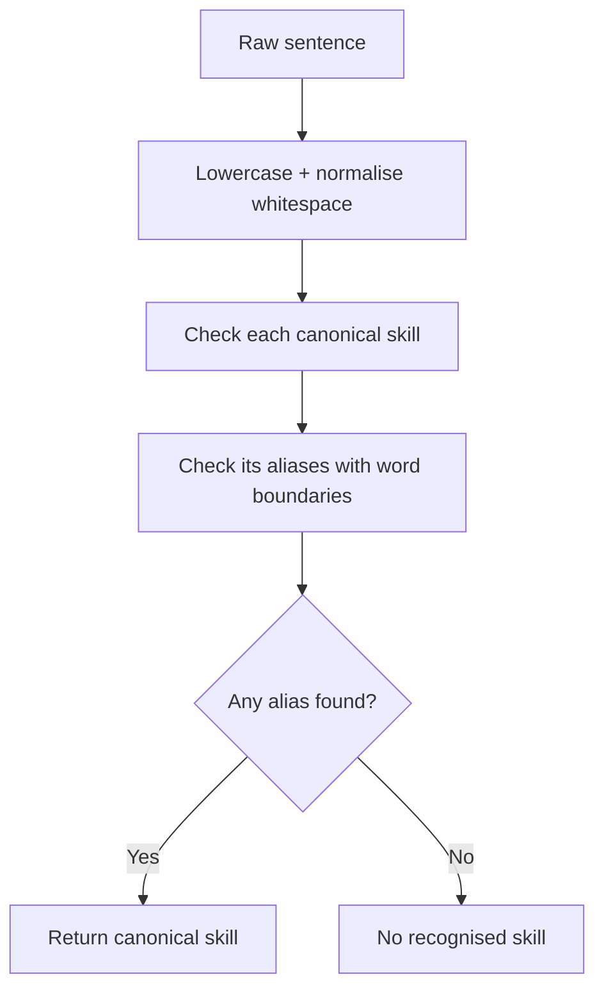

### Visual 27 — A phrase match is not semantic understanding

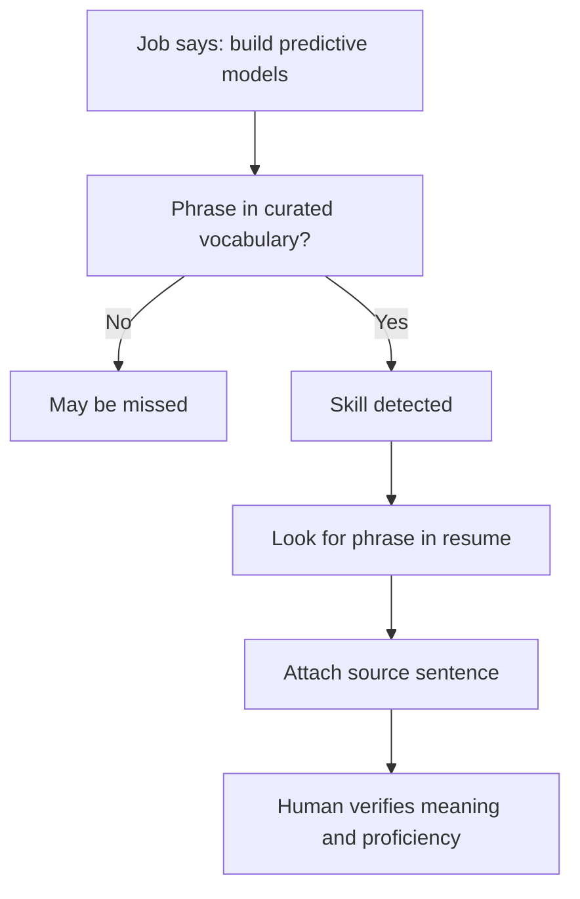

### Visual 28 — Text normalisation and evidence extraction

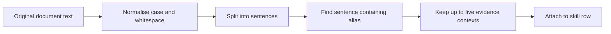

## 3. The scoring formula

For each skill recognised in the job description:

- Weight `2` when nearby wording matches the engine's inferred required-language rules.
- Weight `1` when nearby wording matches its preferred-language rules or no clear priority is identified.
- Earn the skill's weight when that canonical skill is also detected in the resume; otherwise earn zero.

**Formula**

`weighted coverage = (sum of weights for matched job skills / sum of weights for all detected job skills) × 100`

Rounded to the nearest whole number. If no job skills are detected, the score is `0` and the report warns that the vocabulary found nothing. Do not interpret that as zero candidate quality.

### Visual 29 — Score calculation pipeline

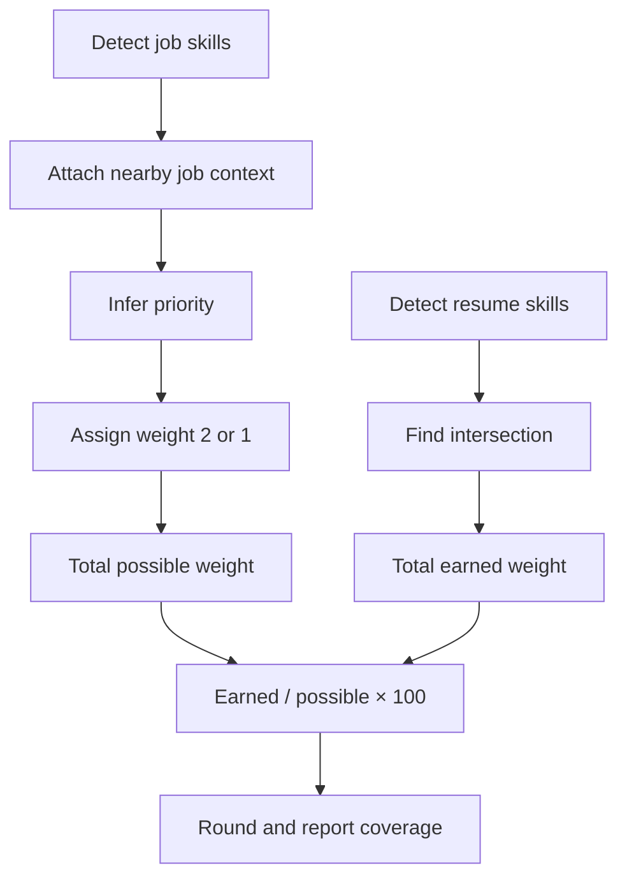

### Visual 30 — Worked example

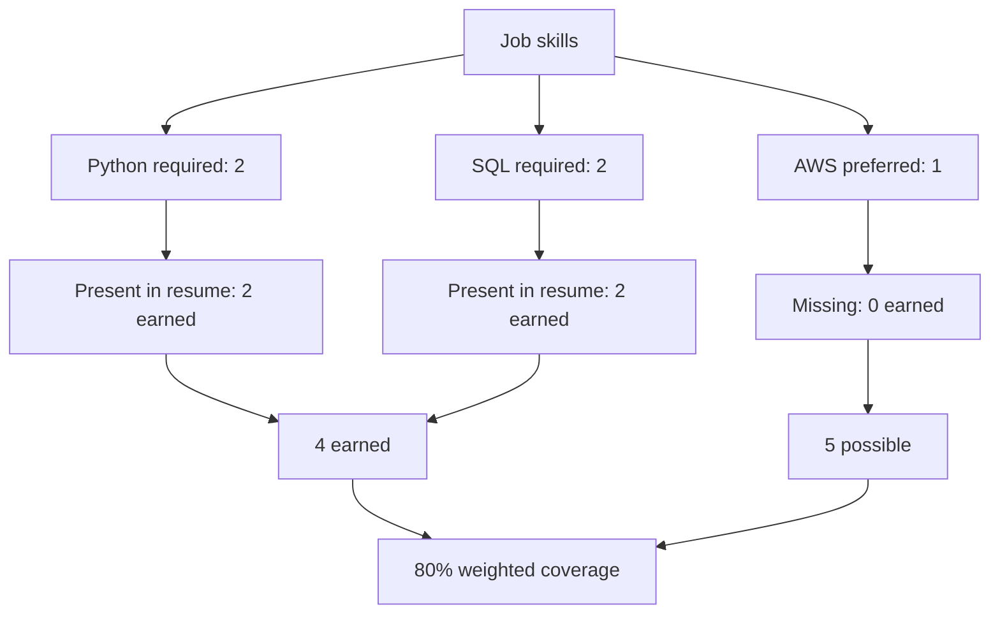

## 4. Priority labels are inferred, not authoritative

The code checks the sentence context around a skill for a list of words. The first required-language test has precedence over preferred-language detection. The labels in the UI explicitly say `(inferred)`.

This can be wrong. For example, a phrase such as “experience with Python is preferred” contains wording from both categories. Depending on the sentence, the current required-language pattern may take precedence. Treat the label as a review hint, not a legal or contractual interpretation of the job posting.

### Visual 31 — Priority classification and precedence

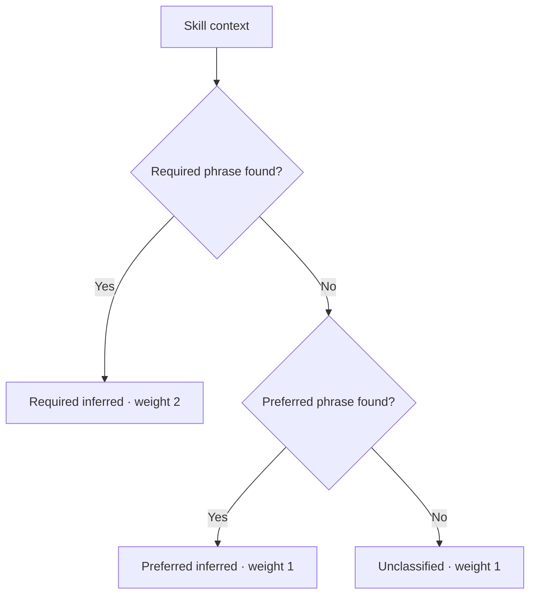

## 5. Read the skill-by-skill table correctly

For each row, inspect:

- **Skill:** canonical term recognised by the engine.
- **Group:** broad category such as Programming, AI & Data, Web & Software, Cloud & DevOps, or Business & Collaboration.
- **Priority:** required/preferred/unclassified inference based on job text.
- **Resume evidence:** source sentences from the resume that mention the term.
- **Job context:** source sentences from the job description that mention it.
- **Present:** whether the canonical skill was detected in both inputs.
- **Weight:** the contribution to the denominator and, when matched, numerator.

### Visual 32 — Anatomy of one skill row

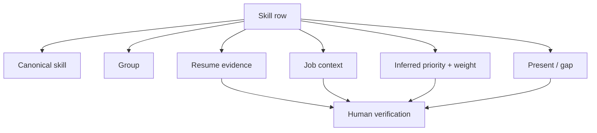

## 6. Turn gaps into actions

A missing term is not an instruction to add that term to the resume. Decide which kind of gap it is:

1. **You have the skill, but the resume does not say it clearly.** Add a truthful bullet or project detail and make the evidence easy to see.
2. **You have adjacent experience.** Explain the transferable task or tool honestly. Do not rename it as a skill you have not used.
3. **You do not have the skill yet.** Treat it as a learning objective, not as resume content.
4. **The engine misunderstood the job wording.** Reject or manually reclassify the finding in your own notes.
5. **The skill vocabulary missed a concept.** Add a vocabulary improvement through code contribution, but do not assume the score is complete today.

### Visual 33 — Gap triage decision tree

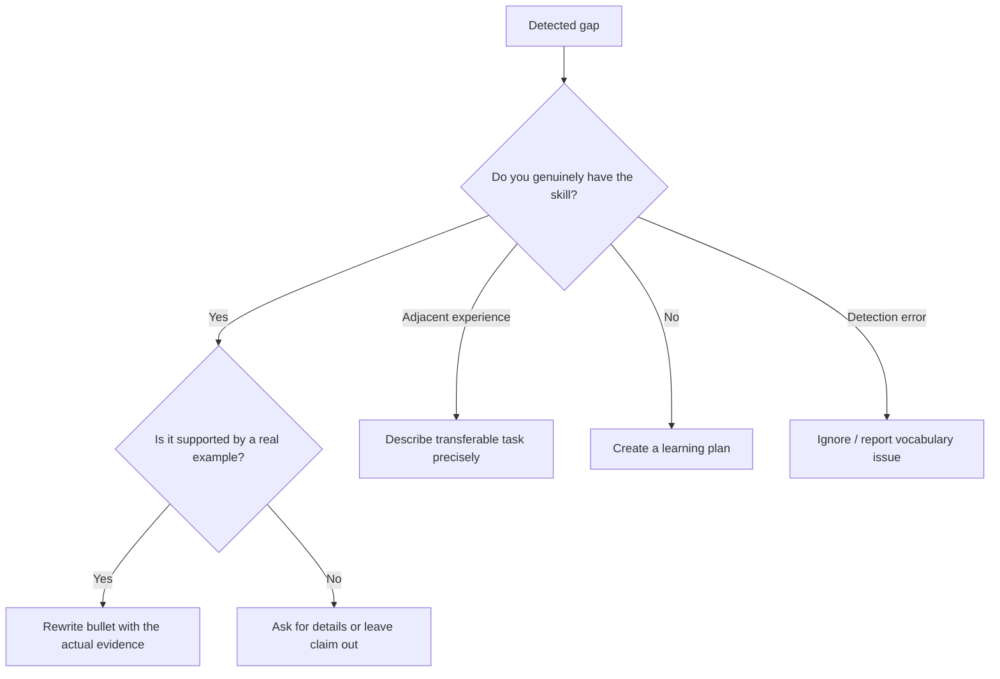

### Visual 34 — Truthful resume rewrite loop

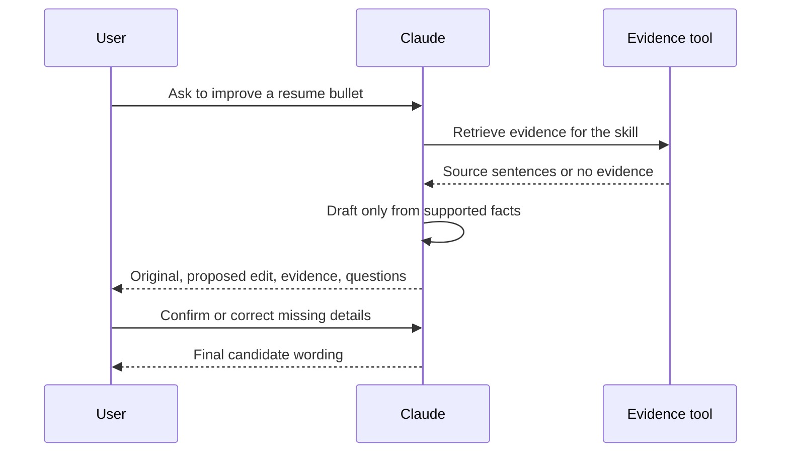

## 7. Write stronger bullets without inventing metrics

A useful bullet often contains **action + context + method/tool + outcome**. The outcome does not always need a number. If a metric is not present in the resume or confirmed by the user, leave a placeholder or ask.

Example transformation:

- Source: `Built a dashboard in Python for weekly sales reporting.`
- Safe rewrite: `Built a Python dashboard to consolidate weekly sales reporting and make recurring trends easier to review.`
- Unsafe rewrite: `Built a Python dashboard that increased revenue by 37% and reduced reporting time by 80%.` — those metrics were not supplied.

### Visual 35 — Bullet construction

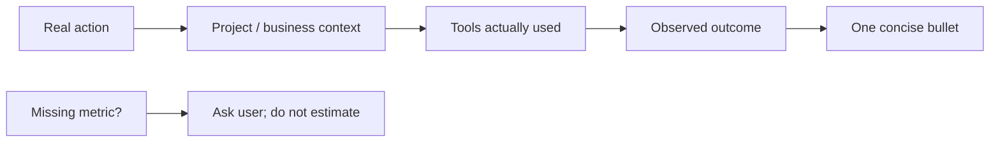

## 8. Export the right format

| Format | Best for | Notes |
|---|---|---|
| Markdown `.md` | Reading, reviewing, sharing with a mentor | Human-friendly headings and source evidence |
| JSON `.json` | Scripts, dashboards, future integrations | Structured fields and arrays; keep the raw file to preserve detail |

### Visual 36 — Export routing

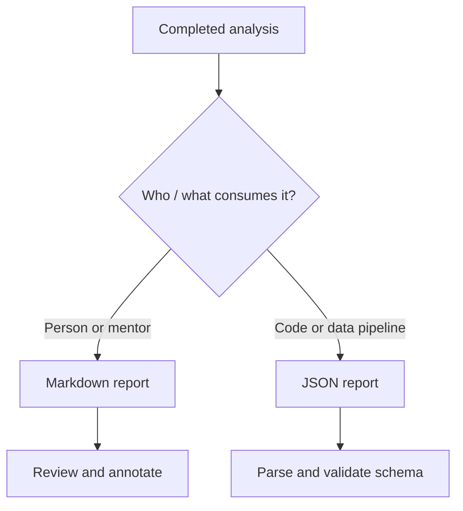

## 9. Quality-control checklist before using a finding

- [ ] Can I point to a sentence in my resume that supports this match?
- [ ] Does the sentence show real use, not only a list of keywords?
- [ ] Did the extracted text preserve the intended meaning?
- [ ] Is the priority label consistent with the full job description?
- [ ] Is the role genuinely relevant to my experience and interests?
- [ ] Have I removed private information from the version I plan to share?
- [ ] Did Claude add any claim or metric I did not provide?

### Visual 37 — Final review gate

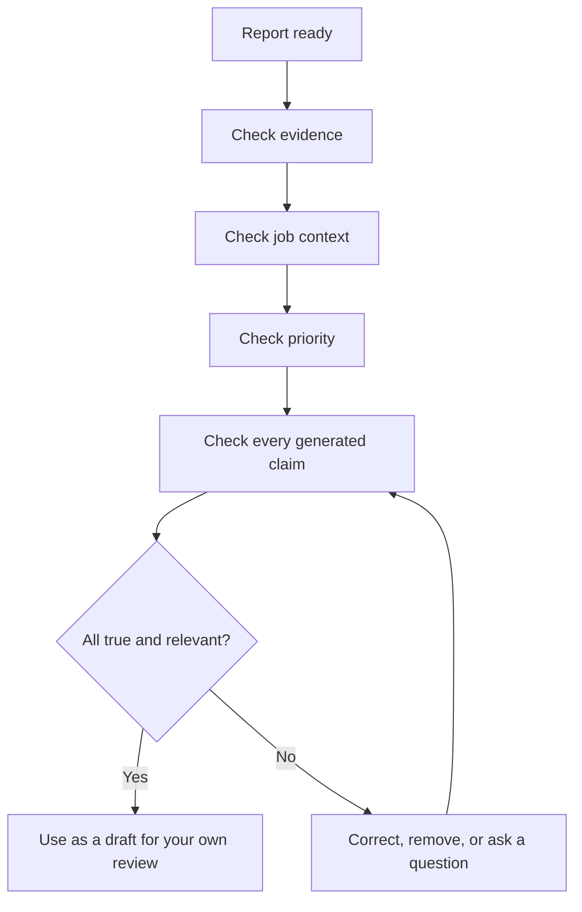

### Visual 38 — What the score should and should not do

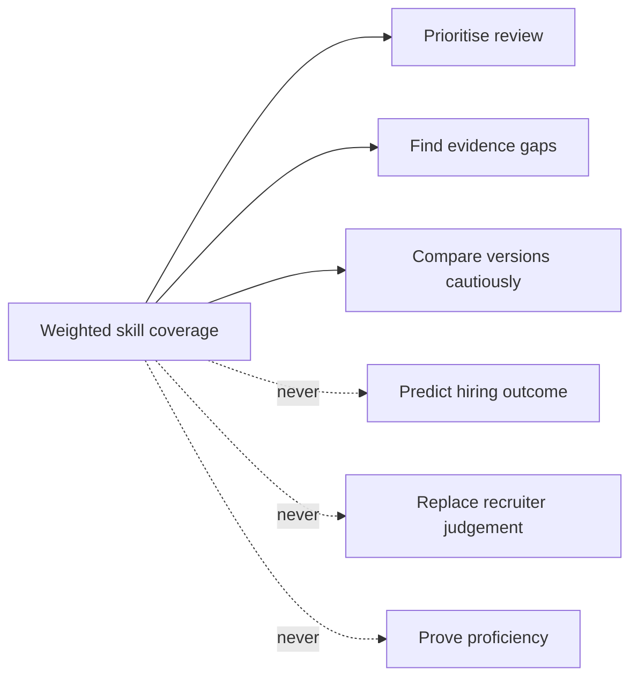

---

**QA-chan's sign-off:** the report is useful only when you inspect the evidence and use your judgement. A score is a navigation aid, not a verdict.