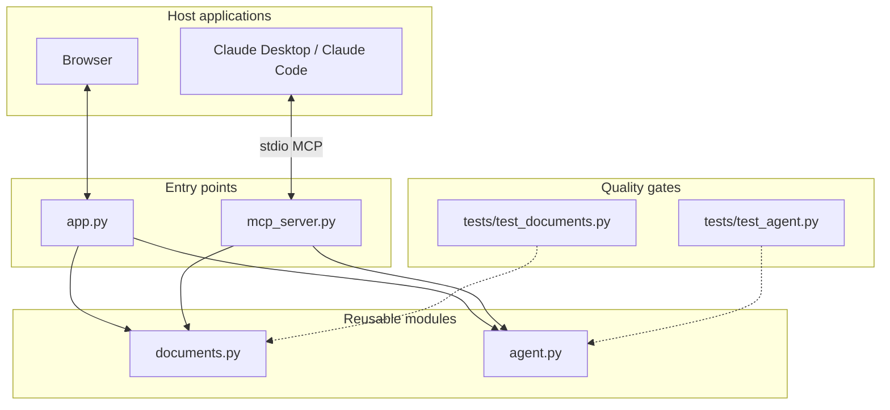
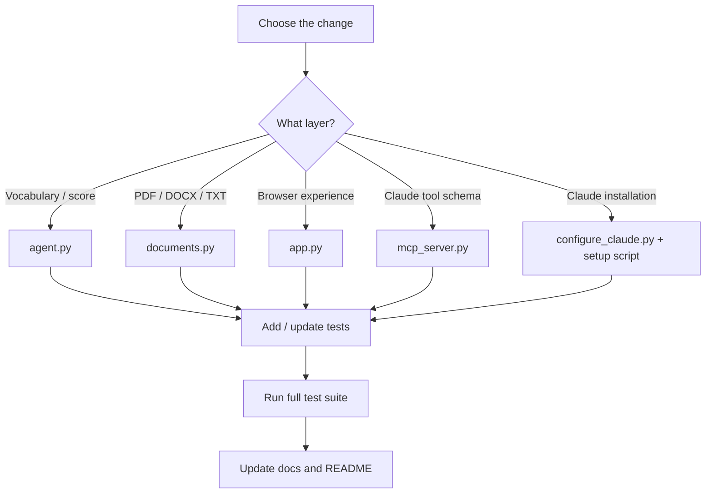

# 04 · Developer Guide — architecture, code paths, tests, and contributions

> **Audience:** developers who want to understand the internals, extend the vocabulary, add capabilities, or contribute a fix.  
> **Goal:** make a change without breaking evidence traceability, offline matching, or the Claude integration.


**Senpai's rule:** preserve one source of truth. The Streamlit UI and MCP tools should call the same tested functions rather than reimplement scoring independently.

## 1. Architecture in one picture

### Visual 39 — Component and dependency architecture



## 2. Responsibility by file

| File | Responsibility | Keep it out of this file |
|---|---|---|
| `agent.py` | Skill vocabulary, normalisation, phrase matching, evidence context, priority heuristic, weighted coverage, report formatting | Streamlit imports, file I/O, Claude API calls |
| `documents.py` | Local PDF/DOCX/TXT extraction and file-size/extension validation | Skill scoring or AI interpretation |
| `app.py` | Browser UI, file upload, input validation, result rendering, export buttons | Duplicate scoring formulas |
| `mcp_server.py` | Expose core functions as MCP tools | Business logic duplicated from `agent.py` |
| `configure_claude.py` | Merge the server config into Claude Desktop's JSON | Hard-coded user-specific paths |
| `setup_claude_windows.bat` | Create venv, install MCP requirements, call configurator | Resume content processing |
| `tests/` | Regression checks for matching and parsing | Network-dependent or private resume data |
| `BENCHMARK.md` | External product references and design rationale | Claims that the project copied other code |

### Visual 40 — Change impact map



## 3. Understand the matching engine

The current `agent.py` pipeline is:

1. Validate that both inputs are non-empty strings.
2. Normalise case and whitespace.
3. Detect canonical skills using `SKILL_ALIASES`.
4. Compare resume and job skill sets.
5. Split source text into sentence-like contexts.
6. Attach up to five matching sentences per skill.
7. Infer priority from nearby wording.
8. Assign weight 2 or 1.
9. Calculate weighted coverage.
10. Generate recommendations and limitations.

Do not silently change the weighting or priority patterns. A change to the algorithm must be documented, tested with edge cases, and reflected in the examples in the user guide.

## 4. Add a new skill safely

Edit `SKILL_ALIASES` in `agent.py`. Use a canonical phrase and aliases that are specific enough not to match common unrelated words.

Example:

```python
"pytorch": ("pytorch", "torch"),
```

Before adding a short alias:

1. Ask whether it has multiple meanings in ordinary text.
2. Check it against common resume phrases and job descriptions.
3. Add a regression test with a positive example.
4. Add a negative example when ambiguity is likely.
5. Put it in the correct `SKILL_GROUPS` category.
6. Review whether `README.md` or the examples need updating.

Do not use a generic single-letter alias such as `R` without contextual disambiguation; this can create many false positives.

### Change checklist

- [ ] Canonical skill is lowercase and stable.
- [ ] Aliases are meaningful and not overly broad.
- [ ] Group membership is sensible.
- [ ] Positive test is included.
- [ ] False-positive/negative test is included where appropriate.
- [ ] Docs explain the new detection coverage.

## 5. Change the scoring logic safely

Before changing `REQUIRED_RE`, `PREFERRED_RE`, or the weight formula, write down:

- intended user-visible behaviour;
- a sentence that should trigger the new rule;
- a sentence that should not trigger it;
- precedence if both patterns occur;
- how the output labels and score change;
- a test asserting the expected score and row weight.

Never describe the score as an ATS score or probability of being hired. It is an explainable, vocabulary-bounded coverage measure.

## 6. Add or improve file parsing

`documents.py` supports `.pdf`, `.docx`, and `.txt` up to 10 MB. PDF handling uses selectable text through `pypdf`; there is no OCR. DOCX handling collects paragraphs and table rows. TXT is decoded as UTF-8 with BOM handling and replacement for invalid sequences.

When modifying extraction:

- Keep the 10 MB limit unless there is a reason and tests to change it.
- Validate extension and existence before reading.
- Return clear `ValueError` messages for user-facing issues.
- Preserve reading order as reliably as the parser allows.
- Do not silently invent text for scanned pages.
- Add tests for valid, empty, oversized, unsupported, and malformed inputs.

## 7. Add an MCP tool responsibly

`mcp_server.py` uses `MCPServer` from the MCP Python SDK and registers Python functions with `@mcp.tool()`.

Tool design checklist:

- Give the function a descriptive name.
- Add type hints to every input.
- Write a one-sentence docstring that tells the model what the tool does.
- Reuse the core engine; do not calculate another score.
- Keep file access limited to a user-supplied path and supported extensions.
- Return predictable dictionaries or strings.
- Never print debugging text to stdout while the `stdio` transport is running. Stdout is the protocol channel; send diagnostics to stderr/logging.
- Add a test for input validation and expected output shape.
- Update the Claude prompt examples and tool table.

## 8. Tests and local quality gates

From the repository root with the intended Python environment active:

```powershell
python -m unittest discover -s tests -v
```

A passing run currently contains 10 tests: six matching-engine tests and four document-extraction tests. Always run the suite after a change. If a new test fails, do not edit the expected value merely to make CI green; first determine whether the changed behaviour is correct.

Useful checks:

```powershell
python -m compileall agent.py app.py documents.py mcp_server.py configure_claude.py
python -m unittest discover -s tests -v
```

## 9. Suggested pull-request workflow

```powershell
git status
git switch -c feat/clear-short-description
# make a small, focused change
python -m unittest discover -s tests -v
git diff --check
git diff
git add .
git commit -m "Add clear short description"
git push -u origin feat/clear-short-description
```

Open a pull request on GitHub. Explain the user problem, the chosen behaviour, screenshots or sample output where relevant, tests run, and any known limitations.

### Contribution standards

- One logical change per pull request.
- Do not commit `.venv/`, `.env`, real resumes, personal data, API keys, or local config files.
- Keep public docs consistent with implementation.
- Prefer small pure functions in the matching engine.
- Do not add a model dependency unless the feature needs one and the user understands the data flow.
- Include regression tests for false positives as well as positive matches.

## 10. Roadmap proposal

| Stage | Capability | Why it matters | Acceptance criteria |
|---|---|---|---|
| A | Better vocabulary coverage | Fewer missed domain terms | Tested alias set and negative cases |
| B | Semantic matching | Recognise related phrases without exact string matches | Clearly labelled semantic mode with confidence/evidence and no invented experience |
| C | Master Resume facts | Store user-confirmed facts for reuse | Explicit confirmation, source citation, edit/delete controls |
| D | Tailored bullet drafts | Make truthful optimisation faster | Before/after plus evidence map and `[ASK USER]` placeholders |
| E | Resume parsing diagnostics | Help users catch layout extraction errors | Warnings for empty columns, missing sections, and unsupported scans |
| F | MCP integration tests | Catch host/tool regressions | Tests call tools through MCP client or Inspector |

---

**Senpai's review:** change the smallest layer that solves the problem; keep the shared engine as the single source of truth; prove the change with tests.