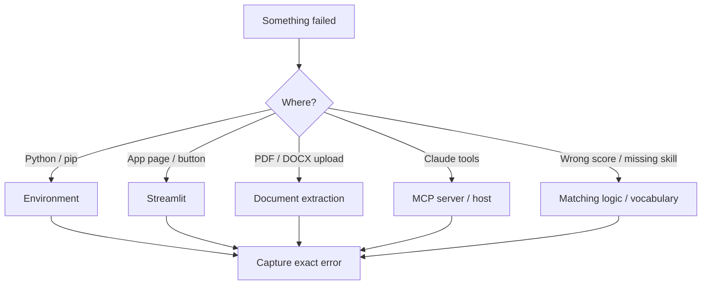
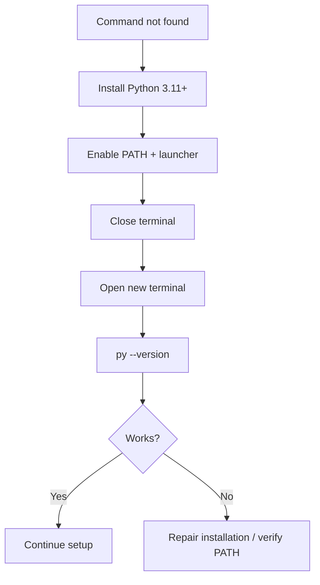
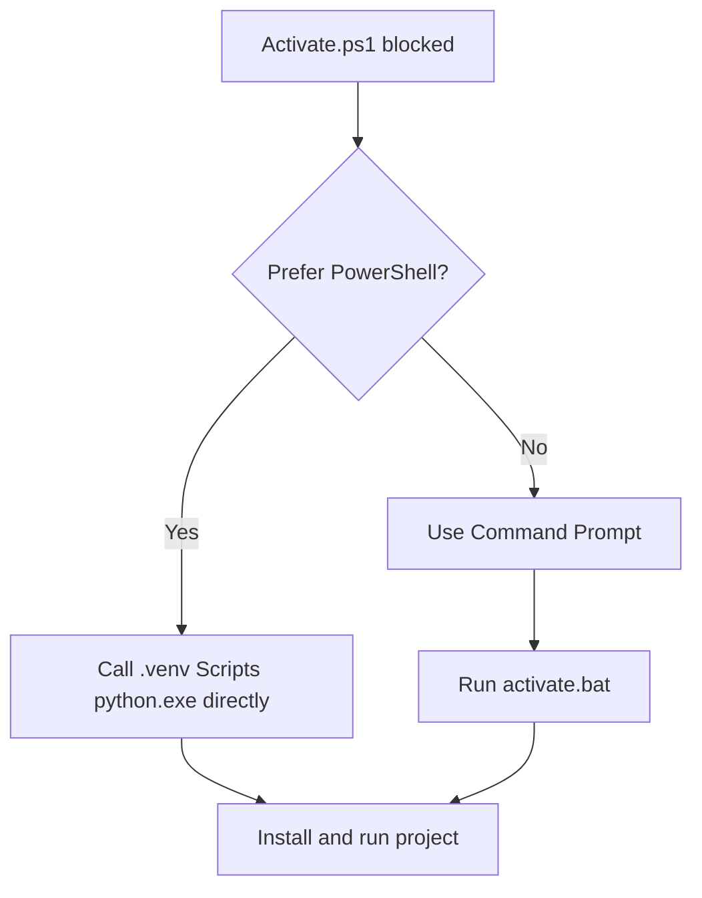
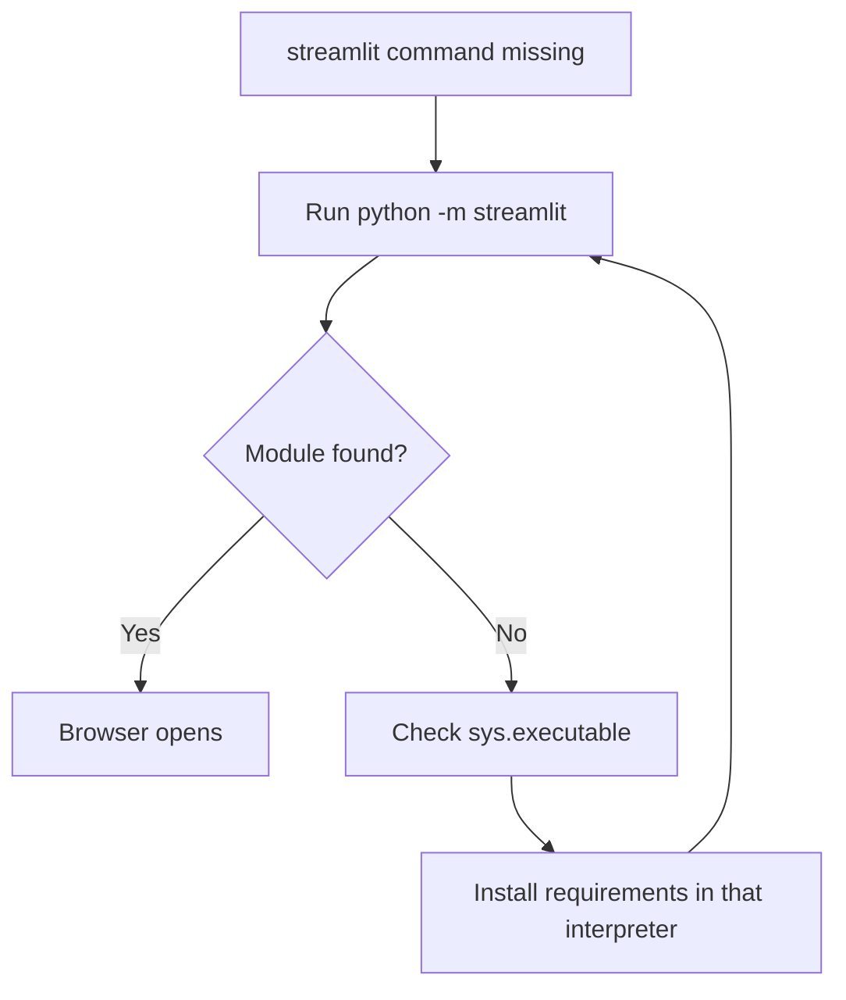
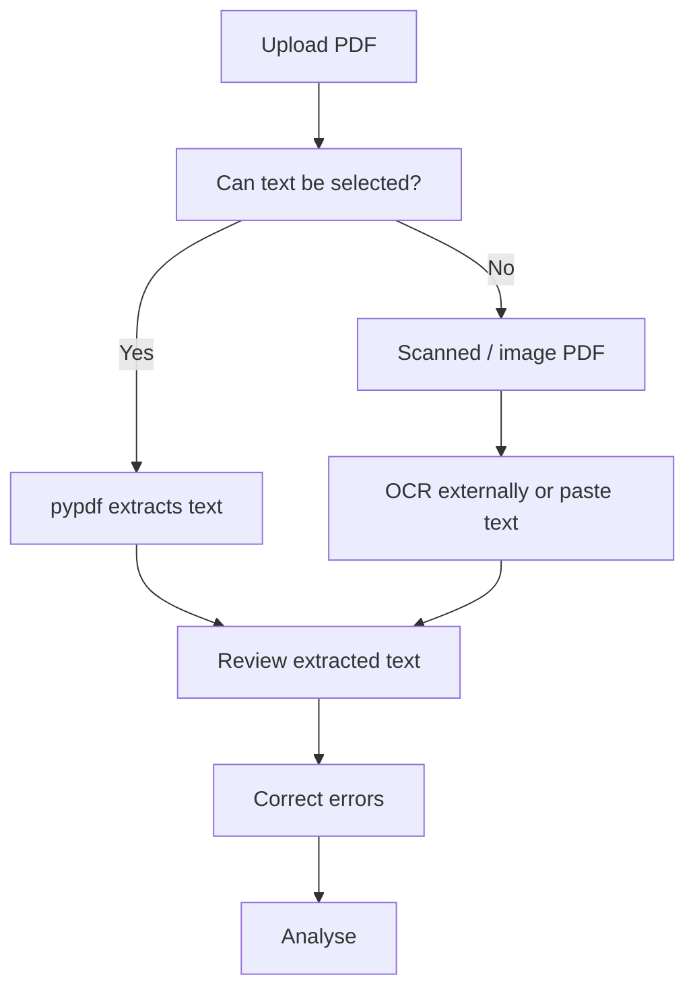
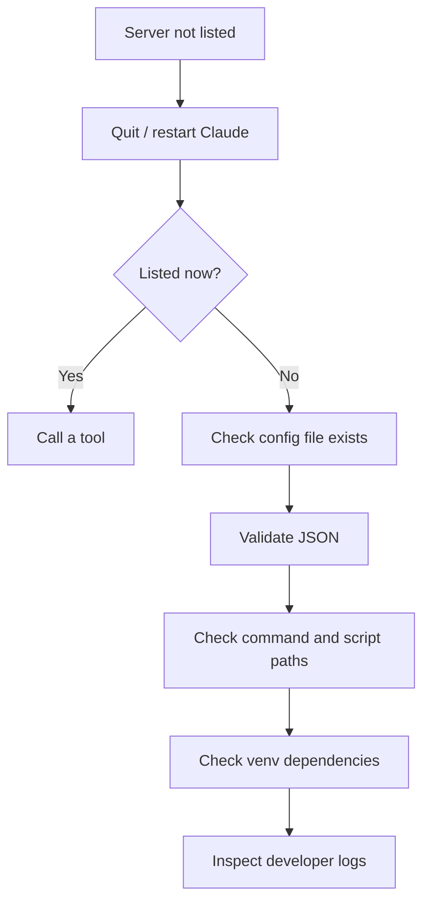
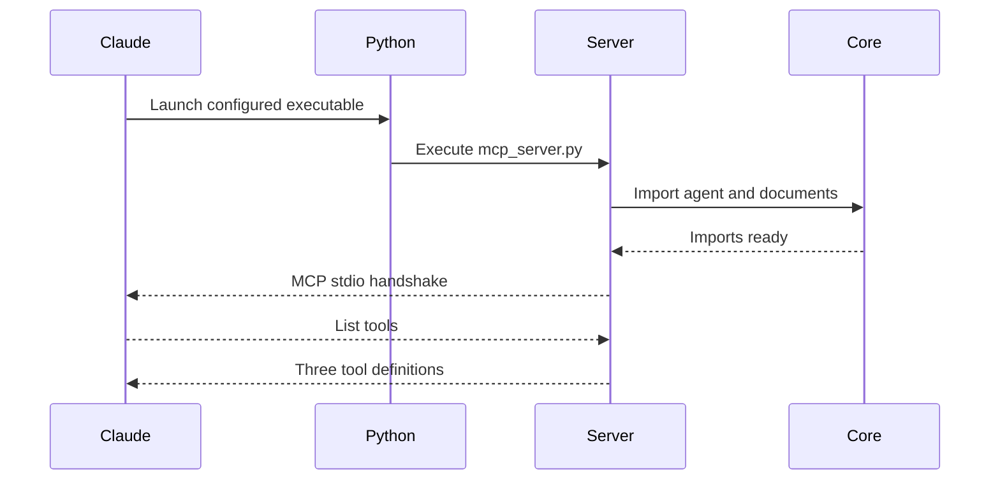
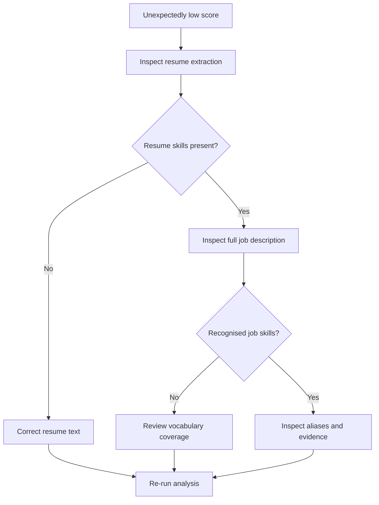
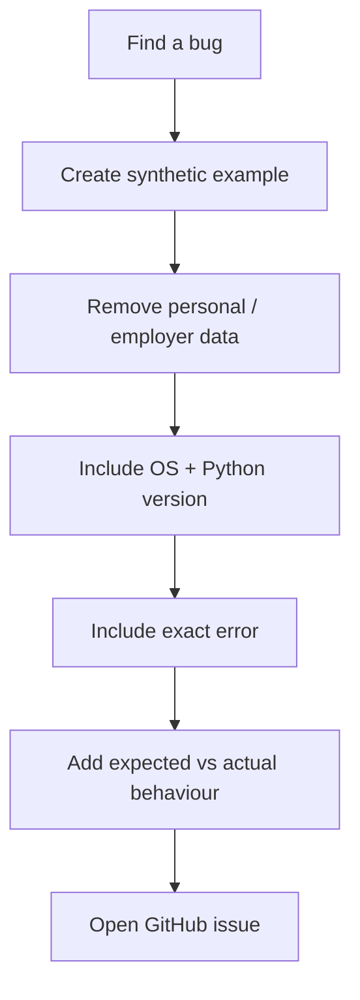
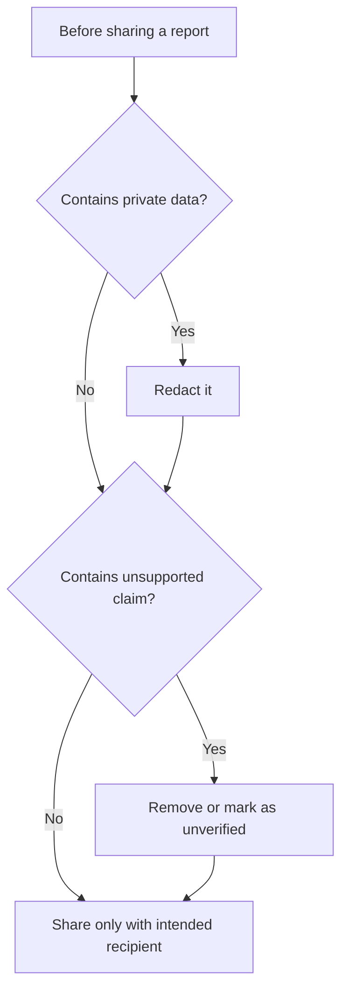

# 05 · Troubleshooting — diagnose, don't randomly reinstall

> **Audience:** anyone whose setup, file parsing, browser app, or Claude integration is not behaving as expected.  
> **Goal:** identify the failing layer and apply the smallest safe fix.


**Kōhai rule:** capture the exact error first. Do not run random commands from the internet or delete your Claude configuration as a first step.

## 1. First identify which layer failed

### Visual 41 — Troubleshooting decision map



## 2. Python or pip is not recognised

**Symptoms**

- `py is not recognized`
- `python is not recognized`
- `pip is not recognized`

**Fix**

1. Install Python 3.11+ from [python.org](https://www.python.org/downloads/windows/).
2. Enable Python Launcher and PATH options in the installer.
3. Close all open terminals.
4. Open a new PowerShell window.
5. Test `py --version` and `python --version`.
6. Use `python -m pip` rather than relying on a standalone `pip` command.

### Visual 42 — Python command repair



## 3. Virtual environment activation is blocked

PowerShell may block the activation script due to execution policy. You do not have to weaken a system-wide policy just to run the project.

Use the environment's executable directly:

```powershell
.\.venv\Scripts\python.exe -m pip install -r requirements.txt
.\.venv\Scripts\python.exe -m streamlit run app.py
```

Or open Command Prompt and run:

```bat
.venv\Scripts\activate.bat
```

### Visual 43 — Safe activation alternatives



## 4. `pip install` fails

Check:

```powershell
python --version
python -m pip --version
python -m pip install --upgrade pip
```

Then retry:

```powershell
python -m pip install -r requirements.txt
```

If the error names a specific package, copy the full error text. Check internet access, corporate network/proxy restrictions, and whether the intended virtual environment is active. Do not install packages into a different Python version and assume Claude will use them.

## 5. Streamlit says command not found

Run it through the environment interpreter:

```powershell
python -m streamlit run app.py
```

If Python reports `No module named streamlit`, the dependencies were not installed into the active `.venv`. Run `python -m pip install -r requirements.txt` again with the correct interpreter.

### Visual 44 — Streamlit launch repair



## 6. The PDF is rejected or empty

The current PDF reader extracts **selectable text**. It does not run optical character recognition (OCR).

If the PDF is a scan/photo, the extraction can be empty. Options:

1. Open the file and try selecting/copying a sentence with your mouse.
2. If text cannot be selected, run an OCR workflow you trust, then review the resulting text carefully.
3. Paste corrected text directly into the resume text box.
4. Re-run analysis only after checking the extracted text.

Also verify the file is under 10 MB, not password protected, and genuinely a PDF.

### Visual 45 — PDF parsing path



## 7. DOCX layout looks strange

The parser reads paragraphs and table rows. It does not recreate the exact visual layout of Word. Multi-column designs, floating text boxes, unusual headers/footers, icons, and nested tables may not emerge in the original visual order.

Best practice: use a simple single-column resume for matching and inspect extracted text. If a section is missing, copy/paste the text manually.

## 8. Claude Desktop does not show the server

Check these in order:

1. Did you completely quit and reopen Claude Desktop after running setup?
2. Does `%APPDATA%\Claude\claude_desktop_config.json` exist?
3. Is the JSON valid?
4. Does `mcpServers` contain `resume-job-match`?
5. Do the `command` and `args` paths still exist?
6. Does the configured Python executable have packages from `requirements-claude.txt`?
7. Did you move the project folder after setup? If yes, rerun `setup_claude_windows.bat`.

Before manual edits, make a backup:

```powershell
Copy-Item "$env:APPDATA\Claude\claude_desktop_config.json" "$env:APPDATA\Claude\claude_desktop_config.backup.json"
```

Do not replace your whole configuration file with a snippet. Preserve other server entries.

### Visual 46 — Claude Desktop diagnosis



## 9. Claude shows the server, but tool startup fails

A server can be registered but still fail when Claude launches its Python process.

- Run the MCP server manually from the project folder with the configured interpreter to see Python import errors:

```powershell
.\.venv\Scripts\python.exe mcp_server.py
```

This process waits for an MCP client and may appear idle. Press `Ctrl+C` to stop it. Do not type random text into its terminal; it is a protocol server.
- Confirm the interpreter was installed with `requirements-claude.txt`.
- Check that `mcp_server.py`, `agent.py`, and `documents.py` are in the same project folder.
- Check Claude's developer logs for the precise startup error.

### Visual 47 — MCP startup sequence



## 10. Claude Code cannot find the MCP server

- Open Claude Code from the repository folder or use the exact absolute paths in the registration command.
- Verify `claude` is installed and signed in.
- Run `claude mcp` to inspect available CLI commands for your installed version.
- Inside Claude Code, use `/mcp` to inspect configured connections.
- If the project was moved, remove the stale server registration using the supported Claude Code CLI and add it again with the new absolute paths.

Consult the current [Claude Code MCP documentation](https://code.claude.com/docs/en/mcp) for version-specific CLI syntax.

## 11. The app shows a low or zero score

Do not immediately assume that the person is unqualified.

Check:

- Did the PDF/DOCX extraction preserve the resume's skills section?
- Did you paste the full job description?
- Does the role use vocabulary that this project's curated list does not include?
- Are relevant skills expressed using synonyms or project descriptions?
- Is the word only in a company description rather than the job's requirements?

The tool cannot infer every synonym or determine skill level. A zero score means no job skills were detected from the current vocabulary, not “zero employability.”

### Visual 48 — Low-score debugging loop



## 12. Report says a skill is present when it is not relevant

This can occur when the same word is used in a different context. Review the exact resume and job context sentences. Do not rely on the percentage alone. If it is a repeatable false positive, open an issue with a minimal synthetic example that contains no personal resume details.

## 13. Security and privacy checks

- Never commit a real resume or job application packet to GitHub.
- Never send `.env`, API keys, credentials, or private Claude configuration files in a support request.
- Redact names, emails, phone numbers, addresses, and employer-confidential information from bug reports.
- The MCP file tool accepts a local path supplied to it; only point it at documents you are authorised to process.
- A local process does not mean Claude itself is offline. Understand what content you ask Claude to inspect.

### Visual 49 — Safe bug-report flow



### Visual 50 — Stop conditions



---

If you still cannot resolve the issue, open a [GitHub issue](https://github.com/yerageracharan/resume-job-match-agent/issues) with the exact error, your OS, Python version, which setup route you used, and the steps to reproduce it. Use synthetic data only.